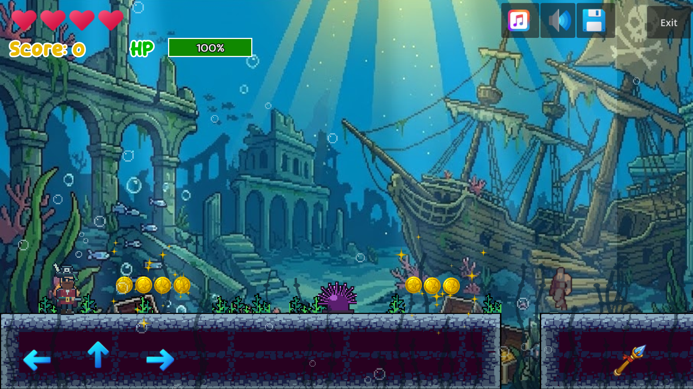
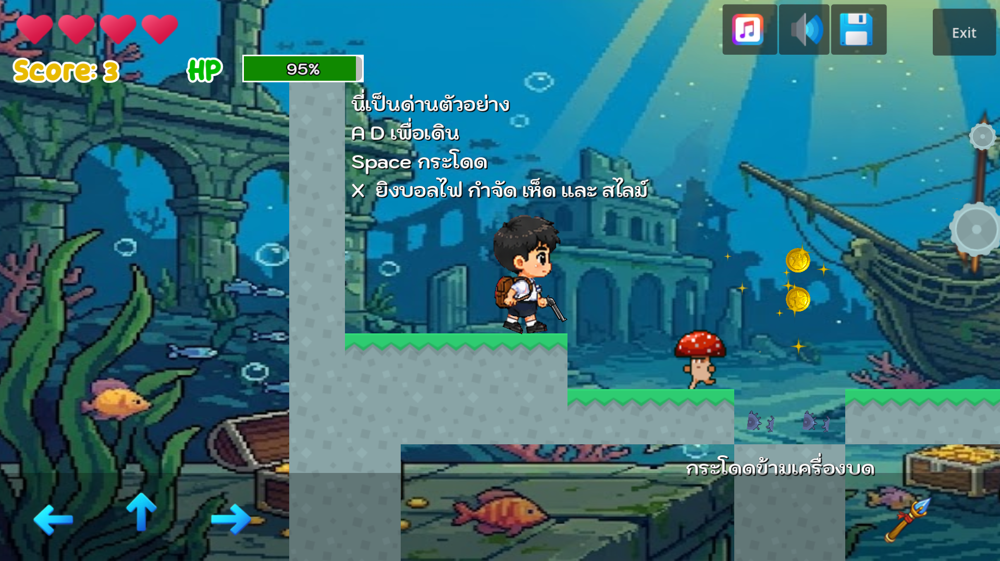

# Game Lab 4: Pirate with Sunken City

**673380318-3 นายธนดล บุตรคุณ**
วิชา Computer Game Development — วิทยาลัยการคอมพิวเตอร์ มหาวิทยาลัยขอนแก่น

**Video:** https://drive.google.com/file/d/1Wh-J0a3eZwEoxambtxmJM8SOUW58cKUk/view?usp=sharing
**Play Game:** https://thanadonb-collab.github.io/game4/

## Game Story

กัปตันโจรสลัดได้แผนที่ขุมทรัพย์ของเมืองบาดาลที่จมอยู่ใต้ทะเล เขาดำดิ่งลงไปบุกซากเมืองโบราณ
ฝ่าดงเม่นทะเล ทุ่นระเบิด สมอยักษ์ที่แกว่งไปมา และฝูงแมงกะพรุน ต่อสู้กับผีทหารเรือ ปลาปิรันย่า และงูทะเล
เพื่อไปให้ถึงห้องเก็บสมบัติบนบัลลังก์ของคราเคน

*A pirate captain dives into a sunken city to plunder its legendary treasure, fighting drowned guards,
piranhas and sea serpents while dodging urchins, sea mines, swinging anchors and jellyfish.*

## Game Style

2D side-scrolling platformer, underwater pirate theme: pixel-art ruins tileset, parallax background
(ocean scene, light rays, two layers of kelp), drifting bubbles, and an original chiptune sea-shanty soundtrack.

## Controls

| Action | Keys |
|---|---|
| Move | A / D or ← / → |
| Jump | Space / W / ↑ |
| Shoot | X (or the on-screen buttons on mobile) |

## Levels (difficulty rises step by step)

| Level | Name | What's new |
|---|---|---|
| 1 | Debtor's Deeps | Small gaps, sea urchins, slow ghouls, giant clam jump pad, first raft |
| 2 | The Overgrown Plaza | Wider gaps, sea mines, jellyfish, raft elevator, whirlpool portal across a trench |
| 3 | Treasure Hall Antechamber | Swinging anchors under ruined arches, jump-bubble tower, elevator pair, eels |
| 4 | The Kraken's Throne | Everything combined: anchor gauntlet, raft over an urchin pit, portal maze, final arena |

Each level is 4–7 screens long and has pirate-flag **checkpoints**.

## Features (by assignment step)

1. **Menu & credits** – Start / Continue / Option / Development Team / Exit, menu music, credits with student name and pirate illustration.
2. **Player & enemies** – Pirate captain cut-out rig (Idle / Walk / Jump / Attack animations); 5 enemy types (ghoul, musketeer, piranha, eel, sea serpent).
3. **Weapon** – Flintlock pistol with matching bullet.
4. **Traps & level objects** – Sea urchins, exploding sea mines, swinging anchors, jellyfish; moving rafts, raft elevators, giant clam jump pads, whirlpool portals, checkpoints.
5. **Items** – Gold coins, heal potion, *Swift Rum* (speed boost), *Air Bubble* (jump boost), heart (extra life).
6. **Levels** – 4 levels built with a TileMapLayer on the sunken-ruins tileset, collision polygons per tile, one-way floating platforms.
7. **Parallax background** – 4 Parallax2D layers.
8. **Game Over / Win** – Illustrated screens with their own jingles; *Play Again* restarts the run.
9. **Music & SFX** – Original level and menu themes, plus effects for shooting, coins, power-ups, explosions, jump pads, portals, checkpoints, hurt and death.
10. **Web build** – Exported to `docs/` and published with GitHub Pages.

## Project

Built with **Godot 4.7** from the [2D Platformer Starter Kit](https://github.com/computingkku/2D-Platformer-Starter-Kit)
by Asst.Dr. Wachirawut Thamviset.
Pirate character art: CraftPix (free pirate sprites).
